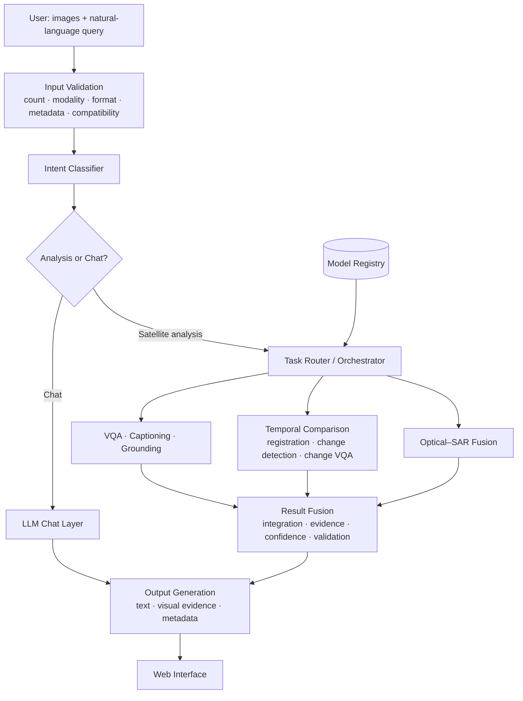

# 🛰️ SatQuery AI

**An agentic vision-language assistant for remote sensing imagery. Ask questions about satellite images in plain English and get answers backed by visual evidence.**


---

## Overview

Satellite imagery is useful for agriculture, disaster response, urban planning, forest monitoring, and water-resource assessment. But getting answers out of it usually means knowing GIS tools, picking the right model, and tuning task-specific parameters.

Most remote-sensing AI is also built as a single-task tool (only classification, only detection, only change detection), and a generic VLM can't handle SAR, multispectral bands, or multi-date pairs reliably.

**SatQuery AI** fixes this with an agentic layer on top of specialist remote-sensing models. You upload imagery and type a question. The system validates the inputs, picks the right model(s), runs them, fuses the outputs, and returns:

- a text answer
- visual evidence (highlighted regions, bounding boxes, change maps)
- a confidence estimate
- an execution trace showing exactly which models ran and with what parameters

```
"What changed between these two dates, and where?"
"Highlight the water body in this image."
"Use the optical and SAR images together to find built-up and water-covered regions."
"Has the built-up area increased, decreased, or stayed the same?"
```

---

## Features

| Capability | Description |
|---|---|
| **Single-image VQA** | Ask free-form questions about an optical/multispectral or SAR image |
| **Captioning / Grounding** | Scene description and text-guided region highlighting |
| **Change analysis** | Change description, change-based VQA, and change maps from bi-temporal pairs |
| **Optical–SAR analysis** | Joint extraction from co-registered optical and SAR pairs (e.g. built-up and water regions) |
| **Agentic orchestration** | Query → task classification → input validation → model selection → execution → fusion |
| **Evidence-grounded output** | Annotations, bounding boxes, change maps, confidence score |
| **Auditable execution trace** | Selected task, models/tools used, permitted parameters, and outputs |
| **Report export** | Download results as a report |
| **Model registry** | Plug in new specialist models without touching the core |

---

## How it works



**Pipeline stages**

1. **Input understanding:** checks image count, modality, format, and metadata, and collects dimensions and statistics.
2. **Intent detection:** works out what the user wants to analyse.
3. **Orchestrator:** selects the workflow and models from the registry, and sets only permitted parameters.
4. **Specialist execution:** runs VQA, grounding, change detection, or optical–SAR analysis.
5. **Result fusion:** combines text and spatial outputs, estimates confidence, and validates results.
6. **Output generation:** returns the answer, visual evidence, and an execution summary.

---

## Supported inputs

| Input type | Description | Used for |
|---|---|---|
| Single image | One optical / multispectral / SAR image | VQA, captioning, grounding |
| Cross-modal pair | Co-registered optical + SAR of the same area | Joint information extraction |
| Bi-temporal pair | Two images of the same area at different times | Change detection, description, change VQA |

**Formats:** GeoTIFF / TIFF for geospatial imagery. PNG / JPEG are accepted only for public benchmark datasets.

---

## Remote-sensing adaptation

A general-purpose VLM isn't enough here, so at least one visual / vision-language component is adapted to remote sensing data.

| Purpose | Dataset |
|---|---|
| Image–text adaptation on multisensor data | [BigEarthNet](https://huggingface.co/datasets/bigearthnet) |
| Captioning, grounding, VQA evaluation | VRSBench, RSVQA |
| Change-based VQA evaluation | CDVQA |
| Optical–SAR paired data | SEN1-2 |

Related work this project builds on or draws from: GeoChat, ChangeChat, RS-ChatGPT, Chat2Geo, Prithvi-100M, AlphaEarth, DOTA.

---

## Tech stack

| Layer | Tools |
|---|---|
| Frontend | React.js, Tailwind CSS, JavaScript |
| Backend | FastAPI, Python, REST API, JSON |
| ML / RS | PyTorch, Hugging Face Transformers, OpenCV, NumPy, Pillow |
| LLM | Together AI (chat layer) |
| Infra | GPU / cloud GPU for inference |
| Tooling | Git, GitHub |

---

## Project structure

> Suggested layout. Adjust to match the repo.

```
satquery-ai/
├── backend/
│   ├── app/
│   │   ├── main.py              # FastAPI entrypoint
│   │   ├── api/                 # REST routes
│   │   ├── orchestrator/        # intent classifier, router, planner
│   │   ├── registry/            # model/tool registry
│   │   ├── preprocessing/       # validation, normalization, metadata
│   │   ├── tools/
│   │   │   ├── vqa/
│   │   │   ├── grounding/
│   │   │   ├── change/
│   │   │   └── optical_sar/
│   │   ├── fusion/              # result fusion + confidence
│   │   └── reports/             # report generation
│   ├── training/                # BigEarthNet adaptation scripts
│   └── requirements.txt
├── frontend/
│   ├── src/
│   └── package.json
├── docs/
└── README.md
```

---

## Getting started

### Prerequisites

- Python 3.10+
- Node.js 18+
- CUDA-capable GPU recommended for the larger models (lightweight models can run on CPU)

### 1. Clone

```bash
git clone https://github.com/abhinavv-13/satquery-ai.git
cd satquery-ai
```

### 2. Backend

```bash
cd backend
python -m venv .venv
source .venv/bin/activate        # Windows: .venv\Scripts\activate
pip install -r requirements.txt
```

Create a `.env` file:

```env
TOGETHER_API_KEY=your_key_here
MODEL_DIR=./models
DEVICE=cuda                      # or cpu
```

Run the API:

```bash
uvicorn app.main:app --reload --port 8000
```

### 3. Frontend

```bash
cd frontend
npm install
npm run dev
```

Open `http://localhost:5173`.

---

## Usage

1. Upload one image, an optical + SAR pair, or a before/after pair.
2. SatQuery AI checks the inputs and shows what it detected (modality, format, compatibility).
3. Type a question, or use a preset (*Describe scene*, *Detect water*, *What changed?*).
4. Review the answer, visual evidence, confidence, and execution trace.
5. Download the report.

### Example API call

```bash
curl -X POST http://localhost:8000/api/query \
  -F "images=@before.tif" \
  -F "images=@after.tif" \
  -F "query=What changed between these two dates, and where?"
```

```json
{
  "task": "change_vqa",
  "answer": "...",
  "confidence": 0.0,
  "evidence": { "change_map": "...", "regions": [] },
  "trace": {
    "models": ["..."],
    "parameters": {},
    "steps": []
  }
}
```

> The response shape above is illustrative. Update it to match the actual API.

---

## Adding a new model

Models are registered in the model registry, so new tools plug in without changes to the orchestrator.

1. Implement the tool interface in `backend/app/tools/<your_tool>/`.
2. Declare its supported modalities, input requirements, and permitted parameters.
3. Register it in `backend/app/registry/`.

The orchestrator will start considering it for matching queries.

---

## Evaluation

| Task | Benchmark |
|---|---|
| Captioning / grounding / VQA | VRSBench, RSVQA |
| Change-based VQA | CDVQA |
| Optical–SAR analysis | Co-registered optical–SAR pairs (e.g. SEN1-2) |

---

## Roadmap

- [ ] Single-image VQA
- [ ] Captioning and text-guided grounding
- [ ] Bi-temporal change description and change VQA
- [ ] Change maps
- [ ] Optical–SAR joint analysis
- [ ] Agentic controller with execution trace
- [ ] Input compatibility checker (GeoTIFF/TIFF)
- [ ] Downloadable reports
- [ ] BigEarthNet adaptation + benchmark evaluation
- [ ] Additional sensors and data sources

---

## Known limitations

- Different models expect different input formats, so everything goes through a shared preprocessing layer.
- Some models are heavy for local machines. Use lightweight variants or cloud GPU.
- Answer quality depends on the underlying adapted models and on well co-registered inputs.

---

## Contributing

PRs and issues are welcome.

1. Fork the repo
2. Create a branch: `git checkout -b feature/your-feature`
3. Commit: `git commit -m "Add your feature"`
4. Push and open a PR

---

## License

MIT. See [LICENSE](LICENSE).

---

## Acknowledgements

BigEarthNet, VRSBench, RSVQA, CDVQA, SEN1-2, GeoChat, ChangeChat, RS-ChatGPT, Chat2Geo, Prithvi, AlphaEarth, DOTA, and the Copernicus / NASA / USGS open data programmes.

---

**Built by [Abhinav](https://github.com/abhinavv-13)**
