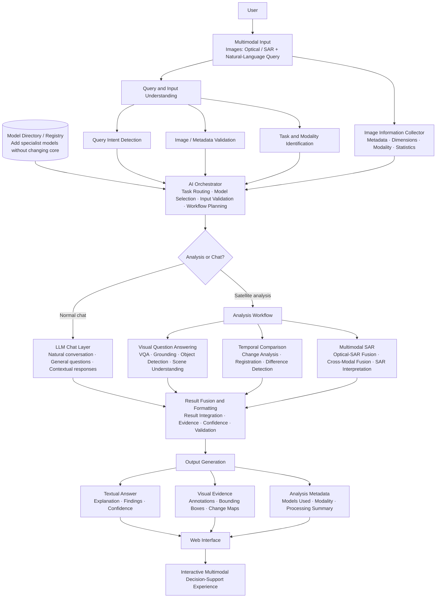

# 🛰️ SatQuery AI


**An Interactive Vision-Language Assistant for Multimodal Remote Sensing Image Analysis through Text Queries**

Ask questions about satellite imagery in plain language, with no GIS expertise or coding. SatQuery AI picks the right remote-sensing models for your query and returns the answer with visual evidence, confidence, and an execution trace.

---

## Overview

Satellite imagery is used for agriculture, disaster management, urban planning, forest monitoring, and water-resource assessment. But most remote-sensing AI is built for one task only (classification, detection, VQA, or change detection), and using it means understanding GIS workflows, model selection, and task-specific parameters. A generic LLM or VLM can't handle SAR, multispectral, or multi-date imagery reliably either.

SatQuery AI is an agentic, query-driven system. It understands the query, validates the images, selects and runs the right specialist models, fuses their outputs, and returns an evidence-grounded response.

Example queries:

- *Describe the land-cover and major objects visible in this image.*
- *Highlight the water body referred to in the query.*
- *What changed between these two dates, and where did the change occur?*
- *Use the optical and SAR images together to identify built-up and water-covered regions.*
- *Has the built-up area increased, decreased, or remained unchanged?*

---

## Features

- **Natural-language interface** for satellite imagery, no GIS expertise needed
- **Intelligent AI orchestrator** that understands the query and imagery, then routes the task to the right model
- **Domain-specific models** instead of a generic vision model
- **Single-image analysis:** VQA, captioning / scene description, text-guided region grounding
- **Change analysis:** change description and change-based VQA from bi-temporal pairs, with change maps
- **Optical–SAR analysis:** complementary information from co-registered optical/multispectral and SAR pairs
- **Unified visual analytics:** textual answer + annotations, bounding boxes, and change maps together
- **Confidence + execution trace:** selected task, models/tools used, key parameters
- **Downloadable reports**
- **Model registry:** add new specialist models without touching the core

### Supported inputs

- **Single image:** one optical / multispectral / SAR image
- **Cross-modal pair:** co-registered optical/multispectral + SAR of the same area
- **Bi-temporal pair:** two images of the same area from different dates

Formats: GeoTIFF / TIFF. PNG and JPEG only for public benchmark datasets.

---

## Architecture



Flow in short: **User Input → Intent Classifier → Task Router → Specialist Model → Result Fusion → Output**

- **Multimodal input:** accepts satellite images + natural-language queries
- **Input understanding:** validates images, metadata, and supported modalities
- **Intent detection / task identification:** works out what to analyse and which image type is needed
- **AI orchestrator:** routes each request to the right workflow and selects specialist models dynamically
- **Specialist analysis:** VQA, change detection, SAR analysis
- **Model registry:** lets new models be added easily
- **Information collector:** extracts image metadata and statistics
- **Result fusion:** combines outputs and supporting evidence
- **Output generation:** explanations, visual evidence, and metadata
- **Web interface:** shows everything in an interactive UI

---

## User Interface

- Map / image viewer with layers: **Optical, SAR, NDVI, Change Map**
- Query bar for natural-language questions
- Preset queries: *Describe scene*, *Detect water*, *What changed?*
- Recent investigations list
- Answer panel with **answer, confidence, models used, execution summary, and visual evidence**

---

## Tech Stack

- **Languages / core:** Python, JavaScript
- **AI / ML:** PyTorch, Hugging Face Transformers, OpenCV, Pillow, NumPy
- **LLM:** Together AI
- **Backend:** FastAPI (REST API, JSON)
- **Frontend:** React.js, Tailwind CSS
- **Hardware:** GPU / Cloud GPU for inference
- **Version control:** Git, GitHub

---

## Project Structure

```
satquery-ai/
├── backend/
│   ├── app/
│   │   ├── main.py              # FastAPI entrypoint
│   │   ├── api/                 # REST routes
│   │   ├── preprocessing/       # input validation, normalization, metadata + statistics
│   │   ├── orchestrator/        # intent detection, task routing, model selection, workflow planning
│   │   ├── registry/            # model / tool registry
│   │   ├── chat/                # LLM chat layer (Together AI)
│   │   ├── tools/
│   │   │   ├── vqa/             # VQA, captioning, scene understanding
│   │   │   ├── grounding/       # text-guided region grounding, object detection
│   │   │   ├── change/          # registration, change detection, change VQA
│   │   │   └── optical_sar/     # optical-SAR fusion and interpretation
│   │   ├── fusion/              # result fusion, evidence, confidence
│   │   └── reports/             # downloadable report generation
│   ├── training/                # BigEarthNet adaptation scripts
│   └── requirements.txt
├── frontend/
│   ├── src/
│   └── package.json
├── docs/
├── .env.example
├── LICENSE
└── README.md
```

---

## Getting Started

### 1. Clone

```bash
git clone https://github.com/abhinavv-13/<repo-name>.git
cd <repo-name>
```

### 2. Backend

```bash
cd backend
python -m venv .venv
source .venv/bin/activate        # Windows: .venv\Scripts\activate
pip install -r requirements.txt
```

Add your LLM key in a `.env` file:

```env
TOGETHER_API_KEY=your_key_here
```

Run the API:

```bash
uvicorn app.main:app --reload --port 8000
```

### 3. Frontend

```bash
cd frontend
npm install
npm run dev
```

---

## Usage

1. Upload a single image, an optical + SAR pair, or a before/after pair (GeoTIFF / TIFF).
2. The system checks the input (number of images, modality, format, metadata, compatibility).
3. Type a question or pick a preset.
4. Read the answer and check the visual evidence, confidence, and execution summary.
5. Download the report.

---

## Datasets and References

- **[BigEarthNet](https://huggingface.co/datasets/bigearthnet):** 590k+ patches, used to adapt the vision-language component to remote sensing
- **[VRSBench](https://github.com/Chen-Delin/VRSBench):** 100k+ image-text pairs; evaluates captioning, grounding, and VQA
- **[RSVQA](https://ieeexplore.ieee.org/document/9172634):** foundational VQA methodology for satellite imagery
- **[CDVQA / SECOND](https://arxiv.org/abs/2305.16318):** change detection and change-based VQA
- **[SEN1-2](https://github.com/leonardobeno/SEN1-2):** 282k paired Sentinel-1 (SAR) and Sentinel-2 (optical) patches
- **[DOTA](https://captain-whu.github.io/DOTA/):** oriented object detection and grounding
- **[GeoChat](https://arxiv.org/abs/2311.15826):** conversational RS VLM with region grounding
- **[Prithvi-100M](https://huggingface.co/ibm-nasa-geospatial/Prithvi-100M):** NASA/IBM geospatial foundation model
- **ChangeChat, RS-ChatGPT, Chat2Geo, AlphaEarth:** related work on change captioning, LLM + RS integration, geospatial tasks via ChatGPT, and multi-modal geospatial embeddings

Imagery sources: NASA, ESA Copernicus, USGS.

---

## How It Compares

| Solution | NL Chat | VQA / Grounding | Change Analysis | Optical + SAR | Unified Workflow |
|---|:-:|:-:|:-:|:-:|:-:|
| Google Earth Engine | No | No | Yes | Yes | No |
| ArcGIS Pro | Partial | Partial | Yes | Yes | No |
| Sentinel Hub / EO Browser | No | No | Partial | Yes | No |
| QGIS + Plugins | No | Partial | Yes | Partial | No |
| GeoChat | Yes | Yes | Partial | No | No |
| RS-ChatGPT / ChatEarthNet | Yes | Partial | No | No | No |
| ChangeChat | Partial | No | Yes | No | No |
| Prithvi / AlphaEarth | No | No | Partial | No | No |
| Chat2Geo | Yes | Partial | Partial | Partial | Partial |
| **SatQuery AI** | **Yes** | **Yes** | **Yes** | **Yes** | **Yes** |

Existing tools each cover part of the problem, spread across separate workflows. SatQuery AI brings intent routing, VQA, grounding, change analysis, and optical–SAR fusion into one conversational workflow with visual evidence, confidence, and an execution trace.

---

## Challenges and Approach

- **Compatibility** (models expect different input formats): a standardized preprocessing layer normalizes inputs.
- **Compute** (some models are heavy for local use): pre-trained lightweight models and cloud computing.
- **Scope** (many analysis capabilities to integrate): MVP-first, core tasks first.

---

## Impact

- Natural-language satellite analysis for non-technical users in agriculture, disaster management, and urban planning
- Faster decision support without complex GIS workflows
- Explainable results backed by visual evidence
- Lower cost: less dependence on expensive GIS tools and manual analysis
- Scalable and modular through pre-trained models and cloud deployment
- Supports disaster response, precision agriculture, and sustainable monitoring

---

## Links

- **Project documentation:** _add Google Drive link_
- **Repository:** _add GitHub link_

---

## License

MIT. See [LICENSE](LICENSE).

---

**Built by [Abhinav](https://github.com/abhinavv-13) and team**
